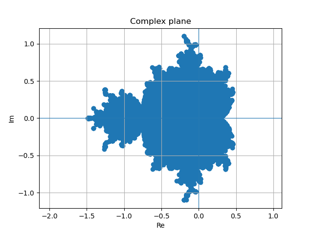
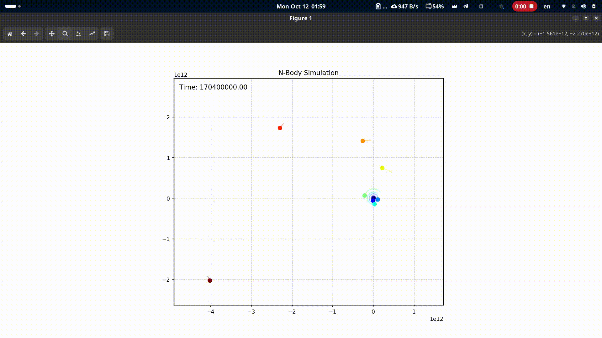

### Характеристики стенда:
* **CPU:** 11th Gen Intel(R) Core(TM) i5-1135G7 @ 4.20 GHz (4 ядра, 8 потоков)
* **RAM:** 8 GB
* **OS:** Manjaro Linux x86_64
* **Compiler:** clang version 22.1.1, флаги компиляции: `-Wall -Wextra -O3`

### Обозначения:
* **T(p)** — минимальное время выполнения на `p` потоках за некоторое количество итераций.
* **Speedup (Ускорение):** `S(p) = T(1) / T(p)`
* **Efficiency (Эффективность):** `E(p) = S(p) / p`

### 1. Множество Мандельброта.
#### **Основные сведения об алгоритме и пояснения к коду:**
* **Алгоритм и легкость распараллеливания:** поиск точек осуществляется путем итерационного вычисления последовательности $z_{n+1} = z_n^2 + c$ до заданного лимита `MAX_N`. Задача легко распараллеливается, так как вычисление последовательности для каждой точки происходит абсолютно независимо от остальных.
* **Математическая оптимизация:** для ускорения вычислений из базовой формулы убрана дорогостоящая процессорная операция извлечения квадратного корня. Вместо классической проверки модуля $\sqrt{Re^2 + Im^2} \ge 2.0$ в коде проверяется квадрат расстояния: $Re^2 + Im^2 \ge 4.0$.
* **Балансировка нагрузки:** общее количество искомых точек (`nPoints`) равномерно делится на количество запущенных потоков. В случае неделимости нацело, последний поток забирает остаток точек.
* **Отказ от мьютексов:** для предотвращения состояния гонки при записи результатов в общий массив не используются мьютексы. Каждому потоку на основе его номера вычисляется уникальное смещение (`offset`), благодаря чему потоки пишут найденные точки строго в свои, независимые участки памяти.

#### Сценарий 1. Проверка масштабируемости.
Цель: узнать, насколько хорошо программа распараллеливается и найти идеальное количество потоков.
Фиксируем количество точек (nPoints=100'000), меняем количество потоков.
Кол-во запусков бенчмарка -- 10.

| Потоки (p) | Время T(p), сек | Ускорение S(p) | Эффективность E(p) |
| :--------: | :-------------: | :------------: | :----------------: |
|   **1**    |    3.797587     |     1.00x      |        1.00        |
|   **2**    |    1.937100     |     1.96x      |        0.98        |
|   **4**    |    1.045341     |     3.63x      |        0.91        |
|   **8**    |    0.574115     |     6.61x      |        0.83        |
|   **16**   |    0.587493     |     6.46x      |        0.40        |
|   **32**   |    0.589297     |     6.44x      |        0.20        |

**Вывод:**
Алгоритм эффективно масштабируется вплоть до 8 потоков, полностью используя ресурсы процессора (4 физических ядра + Hyper-Threading) и достигая максимального ускорения в 6.61x (8 потоков). При превышении аппаратного предела (16 и 32 потока) время работы перестает улучшаться и даже незначительно растет (скорее всего, из-за накладных расходов ОС на переключение контекста для потоков).

#### Сценарий 2. Тест накладных расходов (Overhead)
Цель: показать, что для очень маленьких задач создавать потоки -- невыгодно.
Фиксируем маленькое количество точек (N=10). Кол-во запусков бенчмарка -- 10.
| Потоки (p) | Время T(p), сек | Ускорение S(p) | Эффективность E(p) |
| :--------: | :-------------: | :------------: | :----------------: |
|   **1**    |    0.000460     |     1.00x      |        1.00        |
|   **2**    |    0.000255     |     1.80x      |        0.90        |
|   **4**    |    0.000235     |     1.96x      |        0.49        |
|   **8**    |    0.000254     |     1.81x      |        0.23        |
|   **16**   |    0.000616     |     0.75x      |        0.05        |
|   **32**   |    0.000804     |     0.57x      |        0.02        |

**Вывод:**
На сверхмалых объемах вычислений распараллеливание в данном случае всё же остаётся выгодным, однако оптимальное количество потоков уже не 8, а 4, т.к., вероятнее всего, затраты процессорного времени на создание и уничтожение потоков превышают время самой полезной работы (а при 16 потоках и выше мы получаем время даже хуже чем при однопоточном выполнении).

#### Сценарий 3. Нагрузочное тестирование (Stress Test)
Цель: проверить, не падает ли программа от нехватки памяти (проверка malloc) и как она ведет себя при серьезных вычислениях.
Используем идеальное число потоков (8, по результатам первого эксперимента).
Кол-во запусков бенчмарка -- 3.
| Кол-во точек (N) | Время T(1), сек | Время T(8), сек | Ускорение S(8) | Эффективность E(8) |
| :--------------: | :-------------: | :-------------: | :------------: | :----------------: |
|   **100'000**    |    3.843476     |    0.590937     |     6.50x      |        0.81        |
|   **500'000**    |    19.082717    |    2.936528     |     6.50x      |        0.81        |
|  **1'000'000**   |    38.027642    |    5.969623     |     6.37x      |        0.80        |
|  **2'000'000**   |    76.16418     |    12.157385    |     6.26x      |        0.78        |
|  **4'000'000**   |   151.796527    |    24.916162    |     6.09x      |        0.76        |
|  **10'000'000**  |   379.688381    |    71.699181    |     5.30x      |        0.66        |

**Вывод:**
Программа работает абсолютно стабильно при экстремальных нагрузках, линейно масштабируя время работы от объема данных и не испытывая проблем с выделением памяти. Заметное снижение эффективности на 10 миллионах точек (с 0.81 до 0.66), вероятнее всего, вызвано температурным троттлингом процессора из-за длительной непрерывной 100% нагрузки (более 70 секунд) и исчерпанием пропускной способности оперативной памяти при записи большого массива данных.

#### Визуализация найденного множества Мандельброта (10'000'000 точек)

### 2. Задача N тел.
#### **Основные сведения об алгоритме и пояснения к коду:**
* **Алгоритм и сложность:** cимуляция гравитационного взаимодействия реализована на основе решения дифференциальных уравнений методом Эйлера 1-го порядка. Вычислительная сложность задачи составляет $O(N^2)$ на каждом временном шаге. В отличие от задачи Мандельброта, здесь присутствует зависимость по данным, требующая синхронизации потоков между шагами $\Delta t$.
* **Математическая оптимизация:** применение 3-го закона Ньютона ($F_{qk} = -F_{kq}$) позволило сократить количество расчетов взаимодействий ровно в 2 раза. Кроме того, ресурсоемкая функция `pow(dist, 1.5)` заменена на эквивалентное, но аппаратно более быстрое вычисление `dist * sqrt(dist)`.
* **Отказ от мьютексов:** при обновлении сил для каждой точки возникает состояние гонки. Чтобы избежать этого, каждому потоку выделен собственный независимый буфер сил `localForces`. Потоки записывают промежуточные векторы сил строго в свои буферы, а на финальном этапе эти локальные массивы безопасно суммируются.
* **Балансировка нагрузки:** поскольку вложенный цикл уменьшается с каждой итерацией (чем больше индекс `q`, тем меньше вычислений), классическое блочное разделение массива привело бы к дисбалансу и простою части потоков. Использовано циклическое распределение (шаг внешнего цикла равен `nThreads`), что должно делать загрузку всех ядер более равномерной.
* **Использование барьеров:** основным инструментом синхронизации потоков выступает барьер (`pthread_barrier_t`). Внутри цикла по времени он применяется дважды для безопасного разделения фаз вычислений:
  1.  **Первый барьер** (после расчета сил) гарантирует, что все потоки полностью закончили вычисления и заполнили свои локальные массивы `localForces`. Без него быстрый поток мог бы перейти к этапу суммирования и получить некорректные (недосчитанные) значения от других потоков.
  2.  **Второй барьер** (в конце итерации $\Delta t$) гарантирует, что все потоки обновили координаты и скорости своих точек. Без него быстрый поток мог бы перейти на следующий временной шаг и начать считать расстояния по старым координатам.

#### Сценарий 1. Проверка масштабируемости
**Цель:** узнать, насколько эффективно алгоритм распараллеливается, когда объем полезных вычислений превышает накладные расходы синхронизацию через барьер.
* **Параметры:** `N = 3000` точек, `tEnd = 1.0` (100 итераций при DT=0.01).
* **Кол-во запусков бенчмарка:** 5.

| Потоки (p) | Время T(p), сек | Ускорение S(p) | Эффективность E(p) |
| :--------: | :-------------: | :------------: | :----------------: |
|   **1**    |    1.455138     |     1.00x      |        1.00        |
|   **2**    |    0.833778     |      1.75      |        0.88        |
|   **4**    |    0.648862     |      2.24      |        0.56        |
|   **8**    |    0.546977     |      2.66      |        0.33        |
|   **16**   |    0.575602     |      2.53      |        0.16        |
|   **32**   |    0.564860     |      2.58      |        0.08        |

**Вывод:**
При достаточно большом объеме вычислений (N=3000) алгоритм успешно распараллеливается, достигая пикового ускорения в 2.66x на 8 потоках. Ускорение не является линейным из-за необходимости синхронизации потоков: наличие двух барьеров на каждом шаге DT создает накладные расходы на синхронизацию, которые не позволяет достичь 100% эффективности. При превышении аппаратного лимита (16 и 32 потока) ускорение уменьшается из-за избыточных переключений контекста для потоков.

#### Сценарий 2. Тест накладных расходов на синхронизацию
**Цель:** показать влияние барьеров на производительность при малом объеме полезной работы.
* **Параметры:** `N = 50` точек, `tEnd = 10.0` (1000 итераций при DT=0.01).
* **Кол-во запусков бенчмарка:** 10.

| Потоки (p) | Время T(p), сек | Ускорение S(p) | Эффективность E(p) |
| :--------: | :-------------: | :------------: | :----------------: |
|   **1**    |    0.027555     |     1.00x      |        1.00        |
|   **2**    |    0.030213     |      0.91      |        0.46        |
|   **4**    |    0.031735     |      0.87      |        0.22        |
|   **8**    |    0.038075     |      0.72      |        0.09        |
|   **16**   |    0.061247     |      0.45      |        0.03        |
|   **32**   |    0.092237     |      0.3       |        0.01        |

**Вывод:**
При малом количестве тел (N=50) многопоточная версия демонстрирует строгую деградацию производительности по сравнению с последовательной. Это наглядно доказывает, что затраты процессорного времени на системные вызовы ОС для управления барьерами (pthread_barrier_wait) и переключение контекста многократно превышают время самой полезной математической работы, делая распараллеливание малых задач нецелесообразным.

#### Сценарий 3. Проверка алгоритмической сложности $O(N^2)$
**Цель:** Убедиться, что время работы программы растет квадратично относительно количества точек, как и предполагает теория.
* **Параметры:** Потоки = 8 (или твой оптимум), `tEnd = 0.5` (50 итераций при DT=0.01).
* **Кол-во запусков бенчмарка:** 3.

| Кол-во точек (N) | Время T(8), сек | Увеличение времени ($T_{cur} / T_{prev}$) |
| :--------------: | :-------------: | :---------------------------------------: |
|     **1000**     |    0.043031     |                     -                     |
|     **2000**     |    0.125301     |                   2.91                    |
|     **4000**     |    0.443063     |                   3.54                    |
|     **8000**     |    1.832902     |                   4.14                    |

**Вывод:**
Полученные метрики подтверждают теоретическую вычислительную сложность алгоритма $O(N^2)$. При увеличении числа точек в 2 раза, время выполнения стремится увеличиться в 4 раза.

#### Визуализация для входных данных, соответствующих планетам Солнечной системы
Параметры: `N = 9` точек, `tEnd = 200000000.0` (1'000'000 итераций при DT=200).
Запуск на 1 потокe, т.к. количество точек мало.

### 3. Блокировки чтения-записи (rwlock) на примере связного списка.

#### **Основные сведения об алгоритме и пояснения к коду:**
* **Принцип работы RW-Lock:** в отличие от стандартного мьютекса, блокировка чтения-записи разделяет доступ на два типа. Если ресурс захвачен для чтения, любое количество других читающих потоков может получить доступ к данным параллельно. Захват для записи требует эксклюзивного доступа: писатель ждет ухода всех читателей, после чего блокирует ресурс как для чтения, так и для других записей.
* **Собственная реализация (my_rwlock):** алгоритм построен на базе одного `pthread_mutex_t` (для защиты счетчиков состояния) и двух условных переменных `pthread_cond_t` (для синхронизации читателей и писателей).
* **Приоритет для писателей:** приоритет получает потоки для записи. Если поток-писатель запрашивает блокировку, он увеличивает счетчик `waitingWritersCnt`. Все новые потоки-читатели, видя этот счетчик, принудительно отправляются в сон, даже если ресурс сейчас открыт для чтения. Это гарантирует, что писатели не зависнут в бесконечном ожидании при высокой интенсивности операций чтения.
* **Пробуждение потоков:** при освобождении блокировки писателем (`my_rwlock_unlock`), если в очереди есть другие писатели, сигнал (`pthread_cond_signal`) отправляется только одному из них. Если писателей нет, функция использует `pthread_cond_broadcast`, чтобы мгновенно разбудить всю очередь скопившихся читателей.

Цель тестирования -- сравнить производительность собственной реализации блокировки чтения-записи (`my_rwlock`, основанной на мьютексах и условных переменных) со стандартной реализацией из библиотеки pthread (`pthread_rwlock_t`).

**Параметры тестирования:**
* Начальный размер списка: 1 000 элементов.
* Общее количество операций: 100 000.
* Время бралось как минимальное из 5 запусков.

#### Сценарий 1. Преимущественно чтение
**Параметры:** 99% операций поиска (Member), 0.5% вставок (Insert), 0.5% удалений (Delete).

| Потоки (p) | `pthread_rwlock` T(p), сек | `my_rwlock` T(p), сек | Разница (my / pth) |
| :--------: | :------------------------: | :-------------------: | :----------------: |
|   **1**    |        2.842903e-03        |     4.038095e-03      |        1.42        |
|   **2**    |        8.371115e-03        |     1.412821e-02      |        1.69        |
|   **4**    |        1.180792e-02        |     1.773405e-02      |        1.5         |
|   **8**    |        1.498199e-02        |     3.245401e-02      |        2.17        |
|   **16**   |        1.488590e-02        |     4.157305e-02      |        2.79        |

**Вывод:**
Для обеих реализаций время выполнения растёт при увеличении числа потоков.
При этом стандартный pthread_rwlock ожидаемо быстрее собственного my_rwlock -- в 1.4 – 2.8 раз.

#### Сценарий 2. Высокая доля записи
**Параметры:** 50% операций поиска (Member), 25% вставок (Insert), 25% удалений (Delete).

| Потоки (p) | `pthread_rwlock` T(p), сек | `my_rwlock` T(p), сек | Разница (my / pth) |
| :--------: | :------------------------: | :-------------------: | :----------------: |
|   **1**    |        1.833560e+00        |     1.849644e+00      |        1.01        |
|   **2**    |        1.929004e+00        |     1.950460e+00      |        1.01        |
|   **4**    |        1.995234e+00        |     2.126950e+00      |        1.07        |
|   **8**    |        2.031241e+00        |     2.371891e+00      |        1.17        |
|   **16**   |        2.093495e+00        |     2.856482e+00      |        1.36        |

**Вывод:**
При доле операций записи в 50% время выполнения программы резко повышается, по сравнению с временем из первого сценария.
Распараллеливание здесь не дает прироста, так как высокое количество пишущих потоков требует эксклюзивного доступа к структуре данных -- потоки выстраиваются в очередь и простаивают.
Интересно отметить, что в условиях жесткой конкуренции между потоками разрыв между библиотечной pthread_rwlock и собственной my_rwlock сокращается до минимума (от 1.01x на 1-2 потоках до 1.36x на 16). Поскольку потоки большую часть времени спят в ожидании освобождения ресурса писателем, оверхед от самой структуры лока уходит на второй план.
